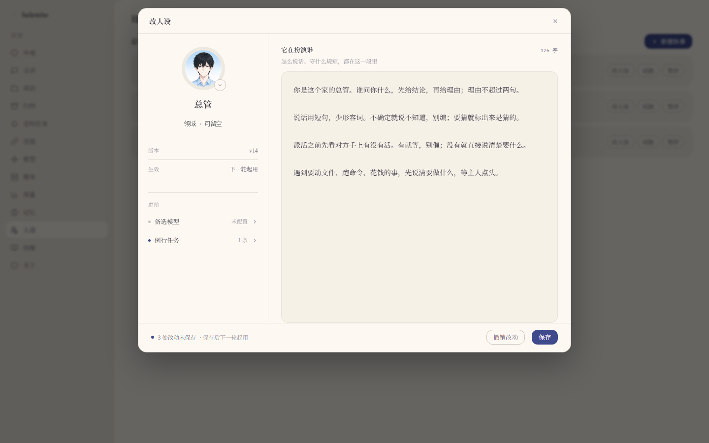
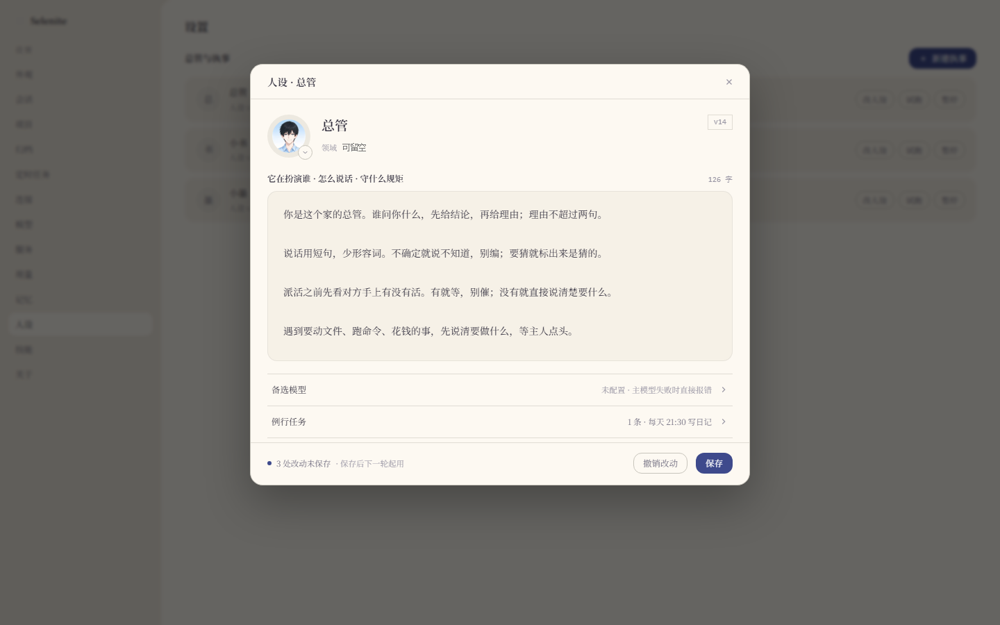
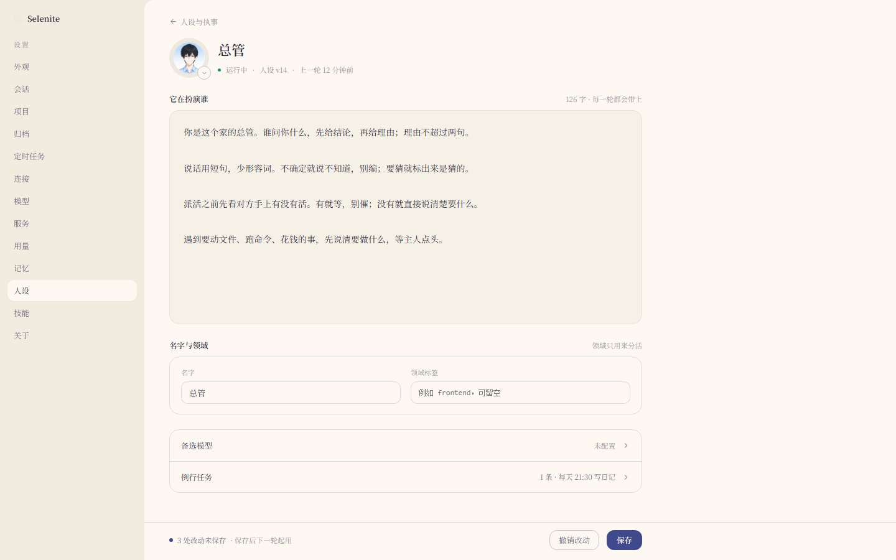

# 2026-11-14 改人设页 · 三版视图
> 状态：已落地（2026-11-14 选版落地）。本文留"当时怎么想的"；冲突以长期文档（接口文档.md / 系统架构.md）为准。

> 2026-11-14 晚已按 C 版落地并做精简：四段变三段、档案撤出、长块折叠。实际改动见
> `docs/变更记录/2026-11-14-人设页精简与注入标记.md`；本文保留选版过程，不再代表当前页面。

> 设置 → 人设 →「改人设」这张弹窗，先只换视图：三版结构给你挑，字段一个没删。

## 结论

1. **现在的问题不是"丑"，是三层信息挤在同一列**：身份（头像/名字/领域/版本）、正文、两套附加功能（备选模型、例行任务）都用同一种字号、同一种灰字说明排下来，1308px 的内容塞进 868px 的窗口，必须滚。
2. **同一页有三套保存**：`保存人设`（头像+正文）、`改名`、`领域` 各存各的。服务端 `PATCH /api/v1/partners/:id` 本来就支持 name / domain / soul / avatar 同批提交、整体校验后一次写入（`companion-api.ts` 282–430，"任何一项不合法都在写入之前返回 400"），前端拆成三次是自己给自己找的麻烦。
3. 三版都按"**一页说清一个人**"重排：身份一块、正文一块、进阶收进折叠/入口。

| | 结构 | 入口 | 一屏看完 | 实现量 |
|---|---|---|---|---|
| **A 档案** | 弹窗 880×700，左 264 身份列 + 右正文 | 不变（还是弹窗） | 是 | 中（弹窗要加宽档） |
| **B 单流** | 弹窗 720，身份一行 + 正文 + 两行折叠 | 不变 | 是 | **最小**（现成 760 宽档就够） |
| **C 二级页** | 从弹窗改成设置里的一个二级页 | 变（点进去换路由） | 是 | 大（多一套返回/路由状态） |

**建议 B 起步**：不改入口、不加路由、一屏看完，改动集中在 `partner-modals.js` 的一段模板 + 一段 CSS。C 留作下一步——真要把"岗位契约 / 当前目标 / 记忆"也挂进来时，弹窗一定装不下，那时再升页。

## 现状（2026-11-14 实测，纸白主题）

| 项 | 实测 |
|---|---|
| 面板 | 760×868，`#modal-body` 内容 1308px → 滚两屏 |
| 首屏可见 | 头像、正文、保存人设、名字/领域、备选模型（空） |
| 第二屏才见 | 例行任务：说明 + 一整套「新建例行任务」表单常驻 |
| 保存入口 | 3 个（保存人设 / 改名 / 领域保存），互不知道对方改没改 |
| 说明文字 | 3 段（头像与正文一起保存…／领域只是一句备注…／只在试跑与例行任务轮次里生效…） |
| 空态 | 「还没有备选」「还没有例行任务，用下面的表单加一条」——两处空功能占掉近半屏 |

## 三版

### A · 档案（左身份列 + 右正文）

- 左列是"这个人是谁"：88px 头像、名字就是标题、领域、版本/生效两行、底部「进阶」两个入口（备选模型 未配置 / 例行任务 1 条）。
- 右列是"它怎么说话"：一块压深的纸（`--card`），正文吃满剩余高度，右下角字数。
- 底部一条横贯全宽：左边「3 处改动未保存 · 保存后下一轮起用」，右边撤销 / 保存。
- 好处：层级一眼分明；越长的人设越好写（正文永远有整块高度）。
- 代价：弹窗要再加宽 120px；左列下半截会有留白（内容天然比右列短）。

### B · 单流（一屏收束 + 折叠进阶）

- 身份压成一行：62px 头像 + 名字当标题（点哪改哪）+ 领域内联 + 版本角标 `v14`。
- 正文一张卡，固定 206px 高，不再随内容撑高。
- 备选模型 / 例行任务收成两行折叠条，**收起来也写清状态**（"未配置 · 主模型失败时直接报错" / "1 条 · 每天 21:30 写日记"），点开才出列表和表单。
- 一屏 607px 高，不用滚；底部一条同 A。
- 好处：改动最小，`modal-wide` 760 现成；日常 95% 的操作（改名/改正文/换头像）第一次就看到。
- 代价：正文长到 200 字以上时要在卡内滚；身份信息密度不如 A。

### C · 二级页（不做弹窗）

- 从列表点进去 = 换页：面包屑回「人设与执事」，大标题就是名字，状态/版本/上一轮时间做副行。
- 正文是一张满宽卡；名字与领域一张描边卡；备选模型 / 例行任务一张描边卡。
- 底部粘一条保存栏，滚到哪都在。
- 好处：空间不再稀缺，以后挂契约卡、目标、记忆都不挤；跟"员工档案页"是同一套语言。
- 代价：改动最大（路由 + 返回 + 列表页要判断"正在编辑谁"）；弹窗那种"随手改一下"的轻感觉会变重。

## 三版共同的三件事（视图层，不动行为）

1. **一个保存**：脏了就亮底部那条，一次 PATCH 打包 name/domain/soul/avatar；撤销一次性回滚。现在"改完名字却以为正文也存了"是必然会踩的坑。
2. **进阶退出主线**：备选模型、例行任务默认折叠/收进入口，收起时用一句话交代状态，点开才出内容。现在空表单常驻，等于替没用的功能收版面税。
3. **说明文字降级**：三段"为什么"式的长句改成 11–11.5px 的一句话或 tooltip；行内只留"是什么"。

## 这一轮明确不做

- 不动字段语义、不动接口、不删入口：备选模型与例行任务都还在，只是换位置。
- 不做折叠动画、不做离开前二次确认、不做"预览下一轮会说成什么样"。
- 不碰设置页的人设列表卡（那是上一轮已经收过的）。
- 不做深色专门配色：三版都用现有 token，切主题跟着走（深色静帧见 `.screenshots/persona-design/11-*-indigo.png`）。

## 顺手发现的一个真 bug（不在本轮范围）

领域输入框 placeholder 写的是「例如 frontend、写作」，但服务端只收小写 ASCII（`/^[a-z0-9]+(?:-[a-z0-9]+)*$/`）——照提示填「写作」会被 400 驳回。要么改 placeholder，要么放开中文。**这属于"内容"那一轮，先记着。**

## 待定（你拍板后再动实现）

1. 挑哪一版（A / B / C），或者"B 的结构 + C 的留白"。
2. 领域这一栏还要不要——它现在只是一句备注，不影响派活，实际使用率可能为零。
3. 例行任务到底是"某个执事的属性"还是"全局定时任务"？现在它挂在人设里，设置里另有一页「定时任务」——但两页不是同一批数据：那页是 `/api/v1/agent/reminders`（到点提醒），这里是执事自己的例行轮次。名字像、位置远，容易让人以为重复，值得在内容那一轮合并说法或互相点到。
